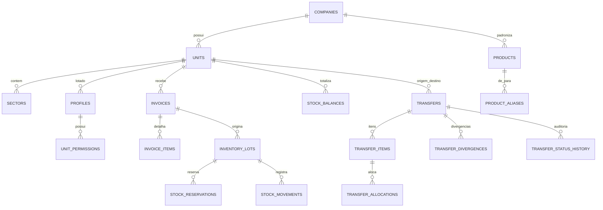

# Dicionário de Dados e Arquitetura do Banco de Dados
## Projeto: CENTRAL DE AVARIAS

---

### 1. Visão Geral das Entidades

O banco de dados relacional foi modelado para PostgreSQL 15+ no Supabase, garantindo integridade referencial estrita (`ON DELETE RESTRICT` em tabelas fiscais e operacionais), chaves compostas para bloqueio de unidade e padronização fiduciária em caixas inteiras (`INTEGER`).

---

### 2. Dicionário de Tabelas

#### 2.1. `companies` (Empresa Controladora)
| Coluna | Tipo | Restrições | Descrição |
|---|---|---|---|
| `id` | UUID | PRIMARY KEY | Identificador único |
| `corporate_name` | VARCHAR(150) | NOT NULL | Razão social oficial |
| `trade_name` | VARCHAR(150) | NOT NULL | Nome fantasia |
| `tax_id` | VARCHAR(18) | UNIQUE, NULLABLE | CNPJ corporativo |
| `is_active` | BOOLEAN | DEFAULT TRUE | Situação cadastral |

#### 2.2. `units` (Unidades: Matriz e Filiais)
| Coluna | Tipo | Restrições | Descrição |
|---|---|---|---|
| `id` | UUID | PRIMARY KEY | Identificador único |
| `company_id` | UUID | FK -> companies(id) | Empresa pertencente |
| `code` | VARCHAR(20) | NOT NULL, UNIQUE(company_id, code) | Código interno (ex: MAT-SC-01) |
| `name` | VARCHAR(100) | NOT NULL | Nome da unidade |
| `city` | VARCHAR(100) | NOT NULL | Cidade da unidade |
| `state_code` | VARCHAR(2) | NOT NULL | Sigla da UF (SC, SP, etc.) |
| `unit_type` | unit_type_enum | NOT NULL | 'HEADQUARTERS' ou 'BRANCH' |
| `tax_id` | VARCHAR(18) | UNIQUE, NULLABLE | CNPJ individual da unidade |

#### 2.3. `sectors` (Setores Físicos de Armazenamento)
* **Chave Única Composta:** `CONSTRAINT uq_sector_id_unit_id UNIQUE (id, unit_id)` — Permite que foreign keys de lotes travem fisicamente a alocação apenas em setores da mesma filial.

#### 2.4. `products` (Catálogo Unificado)
* **Unidade de Medida:** Padronizada exclusivamente em `'CX'` (Caixas) no MVP.
* **Estoque Mínimo:** `minimum_stock_boxes INTEGER NOT NULL CHECK (minimum_stock_boxes >= 0)`.

#### 2.5. `invoices` & `invoice_items` (Staging de Notas Fiscais)
* `access_key`: `VARCHAR(44) UNIQUE CHECK (length(access_key) = 44)`.
* `raw_quantity` e `raw_unit`: Preservam dados originais faturados pelo fornecedor (ex: 120.000 UN).
* `converted_boxes`: Caixas inteiras validadas na conferência humana (`CHECK (converted_boxes >= 0)`).

#### 2.6. `inventory_lots` (Lotes Físicos de Avaria)
| Coluna | Tipo | Restrições | Descrição |
|---|---|---|---|
| `id` | UUID | PRIMARY KEY | Identificador único do lote |
| `unit_id` | UUID | FK -> units | Unidade onde o lote está estocado |
| `sector_id` | UUID | FK -> sectors(id, unit_id) | Setor físico (mesma unidade) |
| `parent_lot_id` | UUID | FK -> inventory_lots | Lote pai na origem (se transferido) |
| `invoice_id` | UUID | FK -> invoices(id, unit_id) | Vínculo com a NF original |
| `current_boxes` | INTEGER | CHECK (current_boxes >= 0) | Saldo físico atual em prateleira |
| `reserved_boxes`| INTEGER | CHECK (reserved_boxes >= 0)| Caixas reservadas para transferência |
| `available_boxes`| INTEGER | GENERATED ALWAYS AS (current - reserved) | Saldo livre para novas operações |

#### 2.7. `stock_reservations` (Tabela Dedicada de Reservas)
* Garante isolamento estrito: reservas de caixas não baixam o saldo físico nem geram saídas contábeis prematuras no ledger.

#### 2.8. `stock_movements` (Livro-Razão Físico Append-Only)
* Movimentações exclusivamente físicas: `INVOICE_ENTRY`, `TRANSFER_OUT`, `TRANSFER_IN`, `INVENTORY_ADJUSTMENT_POS`, `INVENTORY_ADJUSTMENT_NEG`, `WRITE_OFF`.
* Proibição de mutação: Trigger bloqueia qualquer `UPDATE` ou `DELETE`.

#### 2.9. `transfer_divergences` (Quarentena de Sobras Físicas)
* Tipos: `SHORTAGE` (falta), `EXCESS` (sobra física), `DAMAGED_IN_TRANSIT` (avaria no transporte).
* Status: `PENDING_AUTHORIZATION`, `AUTHORIZED_INCORPORATED`, `REJECTED_RETURNED`, `WRITTEN_OFF`.
